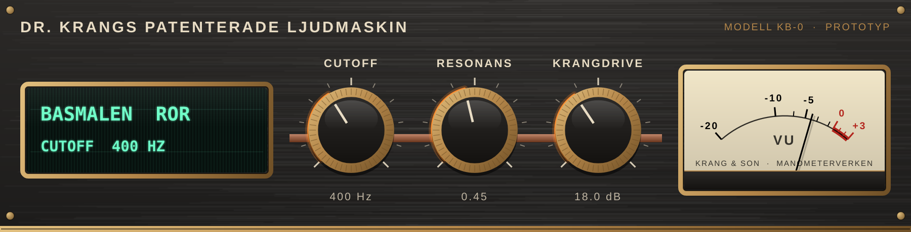

# KrangBox

*Dr. Krangs Patenterade Ljudmaskin* – en trasig synthbox från en dystopisk framtid, byggd av en uppfinnare ur en Jules Verne-roman, med klangfärger från gammal folkmusik.

Instrument-plugin (VST3, AU, CLAP) och fristående app för macOS. Allt ljud är syntetiskt.

**Status: fas 0 – prototyp.** Basmålen (bas) och Krangdistortion är spelbara via MIDI i en DAW eller med det inbyggda virtuella keyboardet. Överst sitter Krang-stilprovet (rattar, VFD-display och VU-mätare); under det ett generiskt testgränssnitt med alla parametrar.



## Bygga lokalt

### Det här behöver du

| Vad | Version | Installera |
| --- | --- | --- |
| Mac | Apple Silicon eller Intel | – |
| macOS | 14 Sonoma eller senare för att bygga (pluginet körs på macOS 11+) | – |
| Xcode | 15 eller senare | App Store, starta en gång och godkänn licensen |
| Xcodes kommandoradsverktyg | – | `xcode-select --install` |
| CMake | 3.22 eller senare | `brew install cmake` |
| Git | – | ingår i kommandoradsverktygen |
| Ninja (valfritt) | – | `brew install ninja`, snabbare bygge under utveckling |
| pluginval (valfritt) | – | [github.com/Tracktion/pluginval](https://github.com/Tracktion/pluginval/releases) |

Homebrew installeras från [brew.sh](https://brew.sh). Första gången du konfigurerar hämtas JUCE 8 och clap-juce-extensions från GitHub, så du behöver internet. Har du redan JUCE lokalt kan du peka på det i stället:

```sh
cmake -B build -G Xcode -DFETCHCONTENT_SOURCE_DIR_JUCE=/sökväg/till/JUCE
```

### Bygga allt (Release, universal binary)

```sh
git clone https://github.com/mikkeschiren/KrangBox.git
cd KrangBox
cmake -B build -G Xcode
cmake --build build --config Release --target KrangBox_All
```

`KrangBox_All` bygger VST3, AU, CLAP och den fristående appen. Byggena hamnar i `build/KrangBox_artefacts/Release/`.

### Snabbare bygge under utveckling

Bygg bara för din egen processor och med debug-information:

```sh
cmake -B build-dev -G Ninja -DCMAKE_BUILD_TYPE=Debug -DCMAKE_OSX_ARCHITECTURES=arm64
cmake --build build-dev --target KrangBox_Standalone
open build-dev/KrangBox_artefacts/Debug/Standalone/KrangBox.app
```

Byt `arm64` mot `x86_64` på en Intel-Mac.

### Byggmål

| Mål | Bygger |
| --- | --- |
| `KrangBox_All` | Alla format nedan |
| `KrangBox_VST3` | `KrangBox.vst3` |
| `KrangBox_AU` | `KrangBox.component` |
| `KrangBox_CLAP` | `KrangBox.clap` |
| `KrangBox_Standalone` | `KrangBox.app` |
| `KrangRender` | Verktyget för lyssningstest (se nedan) |
| `KrangSnapshot` | Ritar stilprovet till PNG: `KrangSnapshot docs/stilprov.png 2` |

### Installera i din DAW

```sh
cp -R build/KrangBox_artefacts/Release/VST3/KrangBox.vst3 ~/Library/Audio/Plug-Ins/VST3/
cp -R build/KrangBox_artefacts/Release/AU/KrangBox.component ~/Library/Audio/Plug-Ins/Components/
mkdir -p ~/Library/Audio/Plug-Ins/CLAP
cp -R build/KrangBox_artefacts/Release/CLAP/KrangBox.clap ~/Library/Audio/Plug-Ins/CLAP/
```

Om Logic inte hittar AU-versionen: kör `killall -9 AudioComponentRegistrar` och starta om Logic. Lokala byggen är inte signerade; macOS kan kräva att du godkänner dem under Systeminställningar > Integritet och säkerhet.

### Felsökning

**`No CMAKE_C_COMPILER could be found` med `-G Xcode`:** Xcode-generatorn kräver hela Xcode, inte bara kommandoradsverktygen. Kontrollera med `xcode-select -p`. Visar den `/Library/Developer/CommandLineTools`, peka om till Xcode och töm byggkatalogen:

```sh
sudo xcode-select -s /Applications/Xcode.app/Contents/Developer
sudo xcodebuild -license accept
xcodebuild -runFirstLaunch
rm -rf build
cmake -B build -G Xcode
```

Utan Xcode installerat går det att bygga med bara kommandoradsverktygen och Ninja:

```sh
rm -rf build
cmake -B build -G Ninja -DCMAKE_BUILD_TYPE=Release
cmake --build build --target KrangBox_All
```

Byggena hamnar då i `build/KrangBox_artefacts/Release/` på samma sätt.

### Validera med pluginval

```sh
pluginval --strictness-level 5 --validate build/KrangBox_artefacts/Release/VST3/KrangBox.vst3
```

## Lyssningstest

```sh
cmake --build build --config Release --target KrangRender
./build/KrangRender_artefacts/Release/KrangRender renders
```

Renderar en basslinga i D-dorisk genom alla fyra distortionslägen (Rör, Fuzz, Vikning, Bitkross) till WAV och kontrollerar NaN, toppnivå, DC och att lägena ligger inom 1,5 dB från varandra i nivå.

## Provspela

Öppna den fristående appen (`KrangBox.app`) eller pluginet i en DAW. Längst ned finns ett virtuellt keyboard (C1–C7): spela med musen, eller klicka på det och använd datorns tangenter `A W S E D F T G Y H U J K`. `OKT -` och `OKT +` flyttar datortangenterna en oktav; de startar på C2, bra för bas. I den fristående appen väljer du ljudkort och MIDI-ingång under *Options*.

## Struktur

| Sökväg | Innehåll | Ansvarig |
| --- | --- | --- |
| `Source/dsp/Basmalen.h` | Basmotor: 2 osc + sub, ladder-filter, envelopes, glid, drift | Sara |
| `Source/dsp/KrangDistortion.h` | Rör, Fuzz, Vikning (4x översamplat), Bitkross | Sara / Justine |
| `Source/dsp/KrangEngine.h` | Kopplar ihop kammare, effekter, DC-spärr och limiter | Justine |
| `Source/Parameters.h` | Parameterträdet – ID:n får aldrig döpas om | Justine |
| `Source/ui/KrangStyle.h` | Krang-stilprov: LookAndFeel, ratt, VFD-display, VU-mätare | Philip |
| `Source/PluginEditor.*` | Stilprov + testgränssnitt + virtuellt keyboard, ersätts av Krang-panelen i fas 2 | Philip |
| `tools/KrangRender.cpp` | Offline-rendering för lyssningstest och CI | Doktor Krang |
| `tools/KrangSnapshot.cpp` | Ritar stilprovet till PNG för granskning utan DAW | Philip |
| `docs/` | Bilder på stilprov och testgränssnitt | – |
| `.github/workflows/` | macOS-bygge, renderingstest och pluginval | Justine |

## Licens

GNU Affero General Public License v3.0 – se [LICENSE](LICENSE). KrangBox använder JUCE under dess AGPLv3-licens.
