# KrangBox

*Dr. Krangs Patenterade Ljudmaskin* – en trasig synthbox från en dystopisk framtid, byggd av en uppfinnare ur en Jules Verne-roman, med klangfärger från gammal folkmusik.

Instrument-plugin (VST3, AU, CLAP) och fristående app för macOS. Allt ljud är syntetiskt.

**Status: fas 3 och 3b klara i kod, grind 3 återstår.** Elva kammare: Basmålen (bas), Hammarverket (trummaskin med Stegverket), Bordunorgeln (drön och folkklanger), Spolslingan (leads och slingor med arpeggiatorn Slingan) Stålpiano (piano, hackbräde och preparerat piano) Klockgjuteriet (klockor och gonger) Kören i schaktet (kör, psalmsång och kulning) Radiomasten (brus, signaler och atmosfär) Lurblåsaren (blåsinstrument) Lutverket (knäppta strängar) och Vattenpumpen (stråkad metall). Kaosmotorn gör allt opålitligt. Alla parametrar sitter på Krang-panelen, som skalas proportionellt mellan 60 och 160 %.

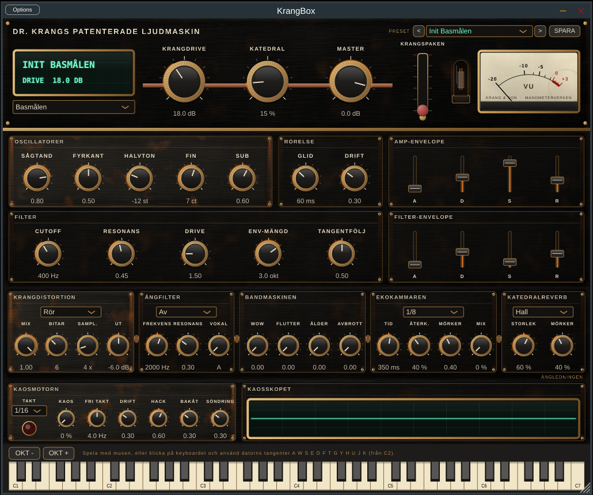

## Krang-panelen

Panelen ritas i en fast designstorlek (1200 × 970) och skalas när du drar i fönstrets hörn (60–160 %, startar på 85 %). Uppifrån:

- **Frontpanelen:** display, kammarväljare, presets och tre stora rattar som gäller alla kamrar: **Krangdrive** (distortionens drive), **Katedral** (reverbens mix) och **Master**. Bredvid sitter **Krangspaken** och ett radiorör som glöder starkare ju hårdare maskinen drivs. VU-mätaren visar utnivån.

### Krangspaken

En makrospak som drar hela maskinen mot sönderfall på en gång: mer drive och full distortion-mix, grövre bitkross, mer drift (tonen glider ur stämning), högre filterresonans, mer rost i trummorna, ett slitnare band, ett självsvängande eko, en Kaosmotor som börjar hacka och mer och mörkare reverb. Nivån kompenseras så att spaken förstör ljudet utan att bara höja volymen. Spaken är en vanlig parameter (*Krangspaken*, 0–100 %) och kan automatiseras i DAW:en; dubbelklick sätter den i botten.
- **Kammaren:** med Basmålen vald visas oscillatorer, rörelse, filter och två envelopes (faders). Med Hammarverket vald visas Stegverket och, i linje med varje spår, rösternas Stämning, Klang och Nivå, samt Rost.
- **Ångledningen:** Krangdistortion → Ångfilter → Bandmaskinen → Ekokammaren → Katedralreverb, sammankopplade med kopparrör. Läget väljs i listan i varje modul.
- **Kaosraden:** Kaosmotorn med kaoslampan, och Kaosskopet – ett oscilloskop som visar utgången.
- **Keyboardet** längst ned.

Displayen visar presetets namn och den parameter du senast rörde. Dubbelklick på en ratt eller fader återställer standardvärdet; små rattar och faders visar värdet medan du drar.

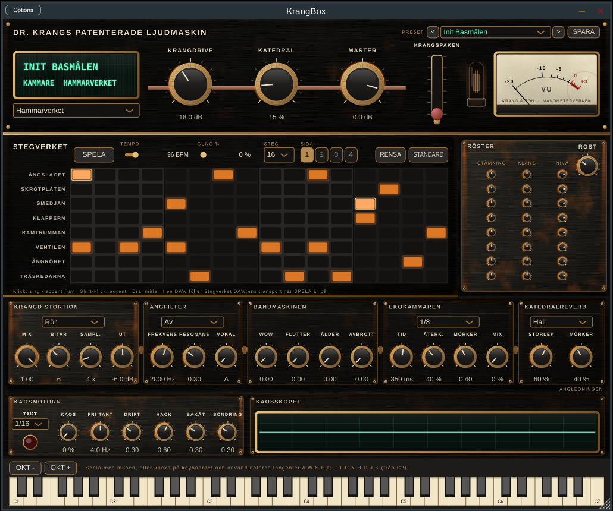

### Texturer

Alla texturer genereras i kod (`Source/ui/Textures.h`) med fasta frön, i dubbel upplösning så att de håller vid 160 % skala: borstad chassimetall, modulplåt med nötta partier, rost och smuts, åldrat mätarpapper med en kaffefläck, korn i VFD-glaset och svarvspår i rattarnas mässing. Statiska bakgrunder ritas en gång och sparas som bild, så en hel omritning tar ungefär 20 ms (mjukvarurendering) och vanliga uppdateringar bara en bråkdel av det.

**Byta mot genererade bilder (Philip):** varje textur är en funktion (`chassisMetal()`, `plate()`, `rust()`, `meterPaper()`) som returnerar en bild. Lägg en sömlös PNG, gärna 512 × 512 eller större, i `Resources/` och låt funktionen returnera den i stället; resten av gränssnittet ändras inte. `KrangSnapshot … --tid` mäter rittiden efteråt.

## Bygga lokalt

### Det här behöver du

| Vad | Version | Installera |
| --- | --- | --- |
| Mac | Apple Silicon eller Intel | – |
| macOS | 14 Sonoma eller senare för att bygga (pluginet körs på macOS 11+) | – |
| Xcode | 15 eller senare | App Store, starta en gång och godkänn licensen |
| Xcodes kommandoradsverktyg | – | `xcode-select --install` |
| CMake | 3.22 eller senare | `brew install cmake` |
| Git | – | ingår i kommandoradsverktygen |
| Ninja (valfritt) | – | `brew install ninja`, snabbare bygge under utveckling |
| pluginval (valfritt) | – | [github.com/Tracktion/pluginval](https://github.com/Tracktion/pluginval/releases) |

Homebrew installeras från [brew.sh](https://brew.sh). Första gången du konfigurerar hämtas JUCE 8 och clap-juce-extensions från GitHub, så du behöver internet. Har du redan JUCE lokalt kan du peka på det i stället:

```sh
cmake -B build -G Xcode -DFETCHCONTENT_SOURCE_DIR_JUCE=/sökväg/till/JUCE
```

### Bygga allt (Release, universal binary)

```sh
git clone https://github.com/mikkeschiren/KrangBox.git
cd KrangBox
cmake -B build -G Xcode
cmake --build build --config Release --target KrangBox_All
```

`KrangBox_All` bygger VST3, AU, CLAP och den fristående appen. Byggena hamnar i `build/KrangBox_artefacts/Release/`.

### Snabbare bygge under utveckling

Bygg bara för din egen processor och med debug-information:

```sh
cmake -B build-dev -G Ninja -DCMAKE_BUILD_TYPE=Debug -DCMAKE_OSX_ARCHITECTURES=arm64
cmake --build build-dev --target KrangBox_Standalone
open build-dev/KrangBox_artefacts/Debug/Standalone/KrangBox.app
```

Byt `arm64` mot `x86_64` på en Intel-Mac.

### Byggmål

| Mål | Bygger |
| --- | --- |
| `KrangBox_All` | Alla format nedan |
| `KrangBox_VST3` | `KrangBox.vst3` |
| `KrangBox_AU` | `KrangBox.component` |
| `KrangBox_CLAP` | `KrangBox.clap` |
| `KrangBox_Standalone` | `KrangBox.app` |
| `KrangRender` | Verktyget för lyssningstest (se nedan) |
| `KrangSnapshot` | Ritar stilprovet till PNG: `KrangSnapshot docs/stilprov.png 2 docs/stegverket.png --tid` (med `--tid`: mäter rittiden, även Kaosskopet); `KrangSnapshot --kaos fil.png` ritar Kaosraden |

### Installera i din DAW

```sh
cp -R build/KrangBox_artefacts/Release/VST3/KrangBox.vst3 ~/Library/Audio/Plug-Ins/VST3/
cp -R build/KrangBox_artefacts/Release/AU/KrangBox.component ~/Library/Audio/Plug-Ins/Components/
mkdir -p ~/Library/Audio/Plug-Ins/CLAP
cp -R build/KrangBox_artefacts/Release/CLAP/KrangBox.clap ~/Library/Audio/Plug-Ins/CLAP/
```

Om Logic inte hittar AU-versionen: kör `killall -9 AudioComponentRegistrar` och starta om Logic. Lokala byggen är inte signerade; macOS kan kräva att du godkänner dem under Systeminställningar > Integritet och säkerhet.

### Felsökning

**`No CMAKE_C_COMPILER could be found` med `-G Xcode`:** Xcode-generatorn kräver hela Xcode, inte bara kommandoradsverktygen. Kontrollera med `xcode-select -p`. Visar den `/Library/Developer/CommandLineTools`, peka om till Xcode och töm byggkatalogen:

```sh
sudo xcode-select -s /Applications/Xcode.app/Contents/Developer
sudo xcodebuild -license accept
xcodebuild -runFirstLaunch
rm -rf build
cmake -B build -G Xcode
```

Utan Xcode installerat går det att bygga med bara kommandoradsverktygen och Ninja:

```sh
rm -rf build
cmake -B build -G Ninja -DCMAKE_BUILD_TYPE=Release
cmake --build build --target KrangBox_All
```

Byggena hamnar då i `build/KrangBox_artefacts/Release/` på samma sätt.

### Validera med pluginval

```sh
pluginval --strictness-level 5 --validate build/KrangBox_artefacts/Release/VST3/KrangBox.vst3
```

## Lyssningstest

```sh
cmake --build build --config Release --target KrangRender
./build/KrangRender_artefacts/Release/KrangRender renders
```

Renderar en basslinga i D-dorisk genom alla fyra distortionslägen (Rör, Fuzz, Vikning, Bitkross), en trumslinga från Hammarverket (torr, Rör och Bitkross), varje trumröst för sig, varje filter- och reverbläge (med hög resonans och stort rum, som stresstest) Stegverkets startmönster och alla fabrikspresets till WAV. Testar också Stegverkets timing mot en simulerad DAW, den interna klockan och gung, på sample-nivå, att alla fabrikspresets ligger mellan −16 och −7 dBFS RMS, och att tre presets förblir stabila med Krangspaken i topp, att Slingan spelar tonerna i rätt ordning och på rätt sample, och att Bordunorgeln med åtta röster håller sig under 25 % av en processorkärna. Ekokammarens tid mäts på sample-nivå, ekot ska överleva 110 % återkoppling, Kaosmotorn ska slå till på taktslagen utan klick och vara helt avstängd på noll. Stålpianot renderas i alla tre lägena, pedalen testas (en släppt ton ska tystna utan pedal och klinga vidare med), och sexton röster ska hålla sig under 25 % av en kärna. Alla sex strängmaterial renderas; stålets ton ska ligga still medan djurhudens sjunker efter anslaget, och silke och djurhud ska klinga kortare än stål. Klockgjuteriet renderas i alla fem klocktyper, även spruckna med Krangspaken i botten; svepet ska höja tonen och tolv gonger ska hålla sig under 25 % av en kärna. Kören renderas i alla röstlägen; vokalerna A och I ska gå att skilja åt i spektrum, och 64 sångare ska hålla sig under 25 % av en kärna. Radiomasten renderas i alla fyra sändningar; telegrafens prickar och streck mäts mot tempot, och storm i botten ska förbli stabil. Lurblåsarens fyra instrument ska ljuda på rätt ton, naturtonerna ska dra tonen till lurens övertoner, och allt i botten ska förbli stabilt. Lutverkets fyra instrument ska ligga rätt i stämning i bas, mellanläge och diskant, dämparen ska tysta släppta toner, och 36 strängar ska hålla sig under 25 % av en kärna. Vattenpumpens fyra metaller ska ligga på rätt ton, sågens glid ska landa på nästa ton, och allt i botten ska förbli stabilt. Kontrollerar NaN, toppnivå, DC och att Basmålens lägen ligger inom 1,5 dB från varandra i nivå.

## Hammarverket

Välj **Hammarverket** i kammarväljaren under displayen på frontpanelen. Åtta helt syntetiska trumröster, var och en med Stämning, Klang (längd) och Nivå, plus *Rost* som lägger skrap och brus på alla röster.

| MIDI-not | Röst | Vad det är | Datortangent (från C2) |
| --- | --- | --- | --- |
| 36 (C2) | Ångslaget | Bastrumma: sinus med tonhöjdsfall, klick och mättning | A |
| 37 (C#2) | Skrotplåten | Rostig plåt: ringmodulerade oharmoniska toner och skrap | W |
| 38 (D2) | Smedjan | Virvel: skinn, sejare och en klang av städ | S |
| 39 (D#2) | Klappern | Handklapp: fyra brusskurar och en svans | E |
| 41 (F2) | Ramtrumman | Folklig ramtrumma: membranets grundton och överton | F |
| 42 (F#2) | Ventilen | Stängd hihat; stryper Ångröret | T |
| 46 (A#2) | Ångröret | Öppen hihat | U |
| 75 (D#5) | Träskedarna | Skedspel: två resonanta träklick | – (musen) |

Noterna 35, 40, 43, 44, 45 och 76 går också till närmaste röst, enligt General MIDI.

## Stegverket

När Hammarverket är valt visas Stegverket under frontpanelen: ett rutnät med ett spår per trumröst och 16 steg per sida.

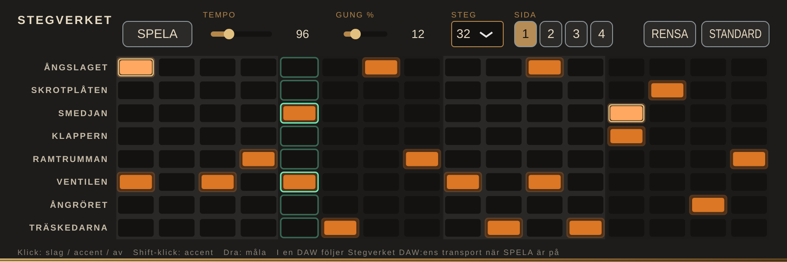

- **Klick** på en lampa växlar av, slag och accent. **Shift-klick** ger accent direkt. **Dra** för att måla samma värde över flera steg.
- **SPELA** startar och stoppar. I den fristående appen går Stegverket på egen klocka med **Tempo**. I en DAW följer det DAW:ens tempo och position när SPELA är på och DAW:en spelar.
- **Gung** låter varannan 16-del släpa, upp till 100 % (en halv 16-del).
- **Steg** sätter längden till 16, 32, 48 eller 64 steg; **Sida** 1–4 väljer vilka 16 steg som visas.
- **RENSA** tömmer mönstret och **STANDARD** laddar startmönstret. Mönstret sparas med DAW-projektet.

## Bordunorgeln

Välj **Bordunorgeln** i kammarväljaren. En polyfon drönmotor (8 röster) med bandbegränsade vågtabeller:

| Kontroll | Vad den gör |
| --- | --- |
| Klangfärg | Glider från vallflöjt (mjuk, udda deltoner) via säckpipa (nasal rörbladston) till nyckelharpa (stråkton med kroppsresonanser) |
| Stråke | Smalbandigt brus kring tredje deltonen, som stråke eller andning |
| Drift | Långsam ostämdhet per röst |
| Bordun + Bordunton | En grundton och kvint i stora oktaven som ligger kvar så länge du håller en tangent |
| Resonans (resonanssträngar) | Sex sympatiska strängar, fysiskt modellerade och stämda efter bordunen (grundton, kvint, oktav, ters, kvart, kvint), som klingar med – som understrängarna på en nyckelharpa |
| Attack, Release | Envelope för alla röster |

Åtta röster använder ungefär 3 % av en processorkärna (mätt i Linux-bygget). Fem presets finns under *Drön och folk*: Bordunorgeln, Nyckelharpan i ruinen, Säckpipan från Ångvik, Vallflöjt i dimman och Rostorgeln.

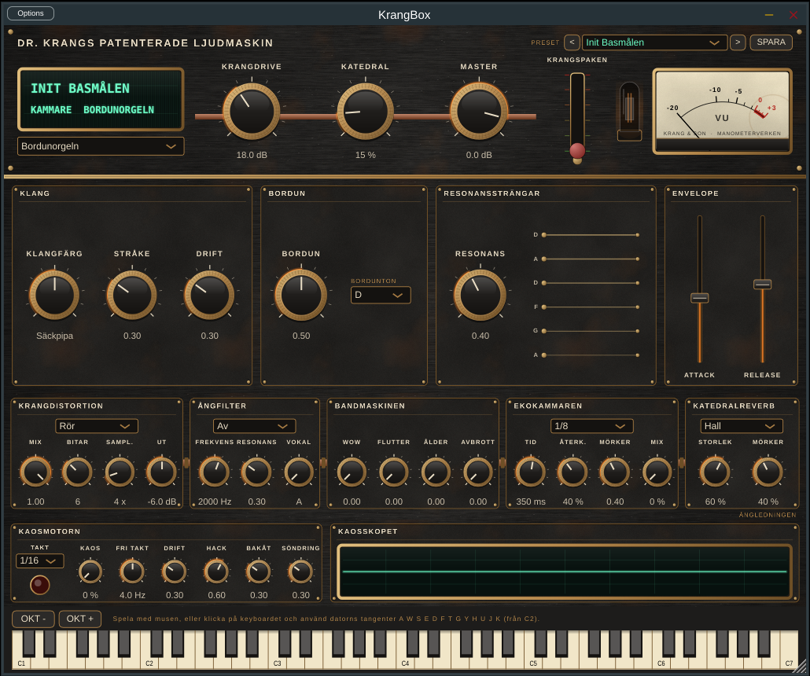

## Spolslingan

Välj **Spolslingan** i kammarväljaren. En polyfon motor (8 röster) för leads, arpeggion och slingor:

| Modul | Kontroller | Vad den gör |
| --- | --- | --- |
| FM-spolen | Ratio, Index, Avklingning | En modulator styr en bärvåg; indexet klingar av efter anslaget så att tonen plinkar från ljus till mörk |
| Munharpa | Munharpa, Munhåla | Ett surrande pulståg (lamellen) genom två resonanser som sveper över deltonerna, som munhålan på en munharpa |
| Radiokorn | Korn, Storlek, Spridning | Granulär effekt: korta korn med slumpad position, tonhöjd och riktning, och ibland tystnad – en trasig radio |
| Slingan | Riktning, Takt, Oktaver | Arpeggiator: Upp, Ned, Upp/ned eller Slump i 1/8, 1/16, 1/16-trioler eller 1/32, över 1–3 oktaver |
| Envelope | Attack, Release | |

Slingan följer DAW:ens tempo och position när DAW:en spelar; annars går den på egen klocka i Stegverkets tempo från första tangenttrycket. Sex presets finns under *Leads och slingor*: Spolslingan, Munharpa i maskinhallen, Kulning över ödemarken, Trasig radio, Ångslinga och Spolpuls i ruinen.

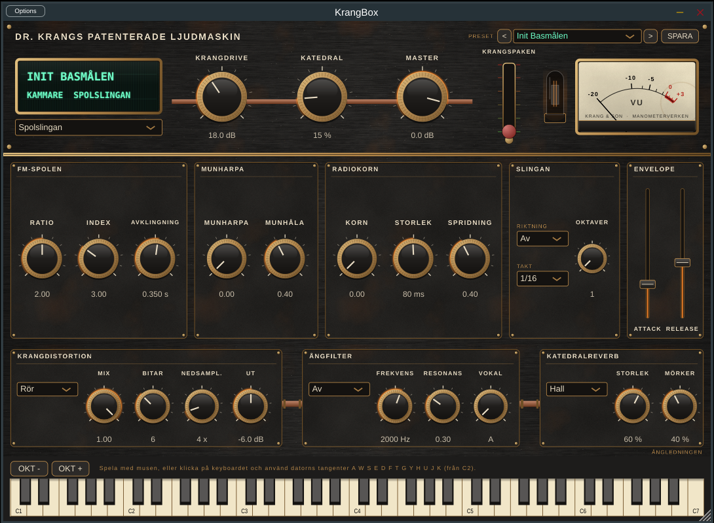

## Stålpiano

Den femte kammaren: piano, hackbräde och preparerat piano med sex strängmaterial, helt syntetiskt med modalsyntes (16 röster). Varje ton är en summa av strängens deltoner, och hammaren är en kort kraftpuls in i dem.

| Läge | Klang |
| --- | --- |
| Piano | Filthammare, två eller tre strängar per ton (en i basen), dämpare när tangenten släpps |
| Hackbräde | Hårda klubbor, tre strängar per kor som svävar mer, inga dämpare – strängarna klingar ut av sig själva |
| Preparerat | Skruvar mellan strängarna: deltonerna förskjuts, klingar kortare och skruvarna klingar med egna oharmoniska toner |

**Strängmaterial** väljs i listan i Strängar-modulen och påverkar styvhet, klingtid, glans och hur jämn strängen är:

| Material | Klang |
| --- | --- |
| Stål | Klar och metallisk, grundljudet |
| Mässing | Varmare och gyllene, lite kortare |
| Koppar | Lindad: mörk, rund och lång |
| Järn | Hårt och ojämnt, med lite rost i sig |
| Silke | Mjukt och kort, tonen sjunker en aning efter anslaget, som en qin |
| Djurhud | Dov och ojämn, med kraftigt duns; spänningen släpper efter slaget så att tonen sjunker som på ett trumskinn |

| Ratt | Vad den gör |
| --- | --- |
| Hårdhet | Mjuk filt till hård stålhammare – hur många höga deltoner som väcks |
| Anslag | Var på strängen hammaren slår; deltoner med nod där tystnar |
| Styvhet | Stålets styvhet: deltonerna dras uppåt, metalliskt och "falskt" |
| Svävning | Hur ostämda strängarna i samma ton är mot varandra (cent) |
| Klingtid | Hur länge mellanregistret klingar; basen klingar längre, diskanten kortare |
| Dämpare | Hur snabbt dämparen tystar en släppt ton |
| Botten | Klangbotten: tre resonanser som ger en trälåda att klinga i |
| Rost | En kedja som rasslar på strängarna, i takt med deras rörelse |

Högerpedalen (sustain, MIDI CC64) håller dämparna borta. Krangspaken ger mer rost, mer svävning och styvare strängar.


## Klockgjuteriet

Den sjätte kammaren: klockor, gonger och metallslag, med samma modalsyntes som Stålpianot men med klockornas oharmoniska deltoner (12 röster).

| Klocktyp | Klang |
| --- | --- |
| Kyrkklocka | Brumton under, ters och kvint ovanför – den klassiska, lite molliga kyrkklockan |
| Skälla | Fäbodens kogälla: kort, ihålig och skramlande |
| Gong | Täta deltoner som klingar länge |
| Räls | En fri stålbalk: få, glesa och mycket oharmoniska deltoner |
| Skålklocka | Sjungande skål: långa toner som svävar i par |

| Ratt | Vad den gör |
| --- | --- |
| Kläpp | Kläppens hårdhet: hur mycket diskant slaget väcker |
| Brum | Brumtonens styrka, oktaven under (kyrkklocka och gong) |
| Svävning | Klockan är aldrig helt rund: varje delton är ett par som svävar mot varandra |
| Spricka | Förskjuter deltonerna, kortar klangen och får sprickan att skorra |
| Svep | Tonen glider efter slaget, upp eller ned (±300 cent), som en operagong |
| Klingtid | Hur länge klockan klingar; låga klockor klingar längre |
| Släpp | Dämpning när tangenten släpps; i botten klingar klockan ut av sig själv |

Krangspaken spräcker klockan och ökar svävningen.

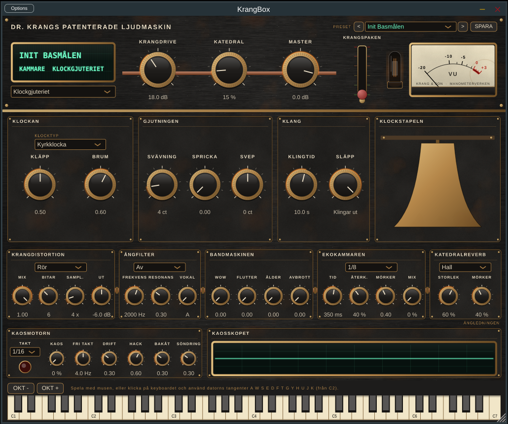

## Kören i schaktet

Den sjunde kammaren: en syntetisk kör med formantsyntes (8 toner, upp till 8 sångare per ton). Varje sångare är lite ostämd, har eget vibrato och egen drift och kommer in lite olika – det är det som gör en kör till en kör. Fem formanter per röst formar vokalen.

| Röster | Klang |
| --- | --- |
| Mansröster | Mansformanter, mörkt och fylligt |
| Kvinnoröster | Kvinnoformanter, ljusare |
| Blandad kör | Varannan sångare med mans- och kvinnoröst |
| Kulning | En ensam röst som glider upp i tonen, glider vidare mellan tonerna och faller av när du släpper |

| Ratt | Vad den gör |
| --- | --- |
| Sångare | Hur många som sjunger varje ton (1–8) |
| Spridning | Hur ostämda och osynkade sångarna är (cent) |
| Vokal | A, E, I, O, U – glider mellan dem |
| Vibrato | Vibratots djup; det kommer in efter en stund, som hos en riktig sångare |
| Andning | Luft i rösten |
| Insats, Avklang | Hur kören tar ton och släpper den |
| Trasig | Kören hörs genom en trasig högtalare i schaktet: smal, skorrande och med glapp i kontakten |

Krangspaken förstör högtalaren och sprider kören isär.

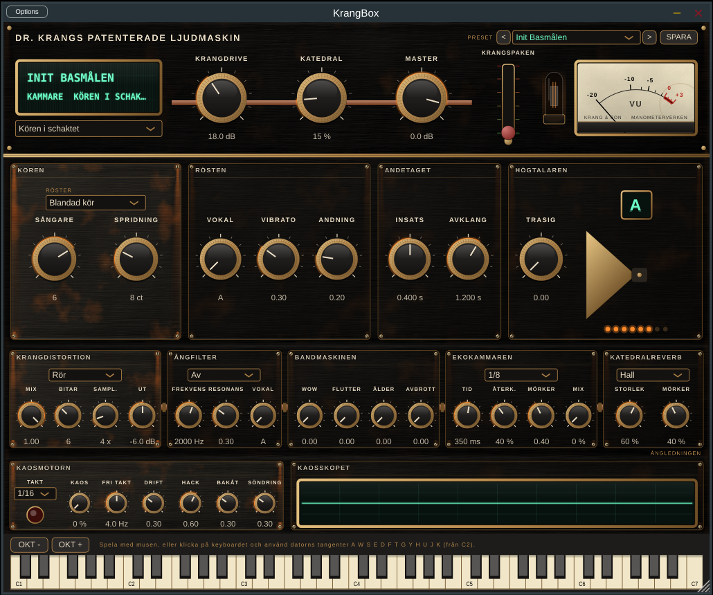

## Radiomasten

Den åttonde kammaren: en spelbar radiomottagare för brus, signaler och atmosfär (8 stationer). Varje ton du spelar ställer in en station på tonens frekvens, och nålen på radioskalan följer den senast spelade tonen.

| Sändning | Klang |
| --- | --- |
| Kortvåg | En visslande bärvåg som driver, och en avlägsen station som pratar i bruset |
| Morse | Telegrafsignaler på tonen, en prick per sextondel i tempot. Olika toner sänder olika meddelanden: KRANG, SOS, VERNE och CQ CQ |
| Vind i ledningar | Vinden sjunger i telegraftrådarna, i byar som väcker trådens övertoner |
| Interferens | En fjärrskrivare som växlar mellan två toner, en svävande störton och nätbrum |

| Ratt | Vad den gör |
| --- | --- |
| Signal | Hur stark stationen är mot bruset |
| Bandbredd | Mottagarens bandbredd: smal och burkig, eller bred och fräsig |
| Brus | Mottagarens sus |
| Drift | Stationen glider ur inställning |
| Fading | Signalen sjunker undan och kommer tillbaka |
| Storm | Åskknaster |
| Insats, Avklang | Hur stationen kommer och går |

Krangspaken drar in åskan över masten: mer storm, fading och drift.

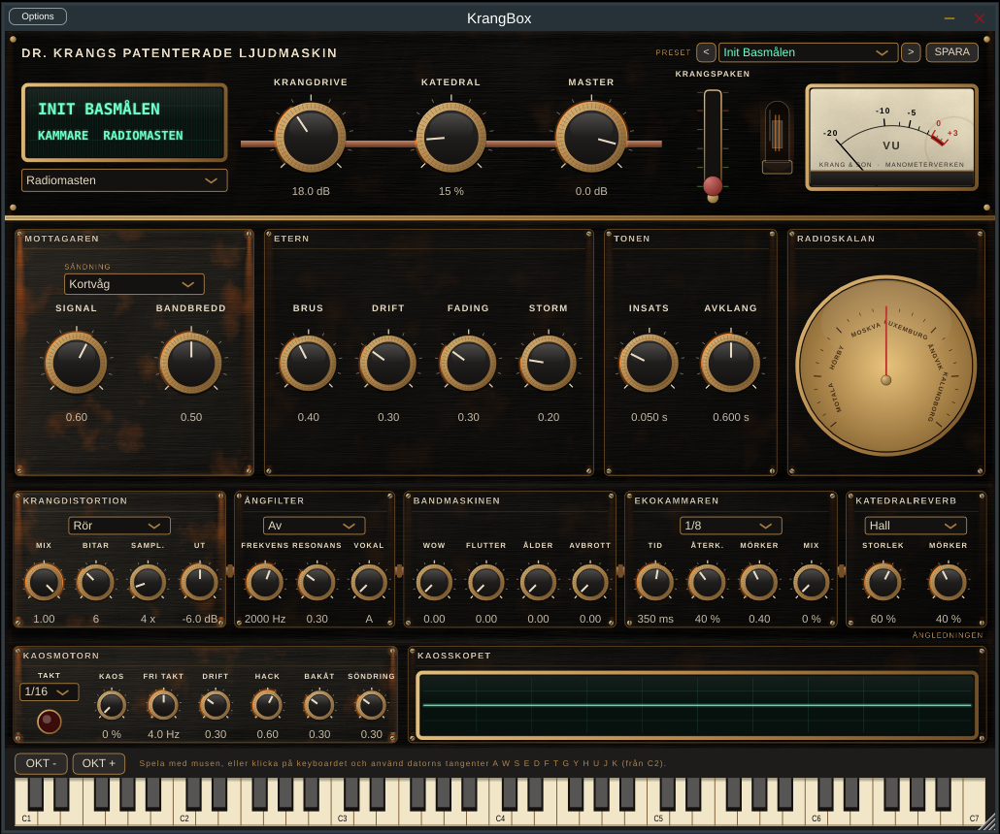

## Lurblåsaren

Den nionde kammaren: blåsinstrument med vågledarsyntes (6 röster). En fördröjning är instrumentets rör, och munstycket driver luftpelaren.

| Instrument | Klang |
| --- | --- |
| Näverlur | Läpparna surrar mot ett långt rör; högre blåstryck ger ljusare och skarpare ton |
| Bockhorn | Kortare och skrovligare, med mer rasp |
| Skalmeja | Ett rörblad som slår mot munstycket, som säckpipans pipa (Perry Cooks klarinettmodell ur STK) |
| Ångvissla | En ton som vevar upp när ångtrycket byggs, med fladder och väsande ånga |

**Naturtoner:** med På har näverluren en fast längd (Lurens ton), och läpparna kan bara hitta rörets naturtoner – övertonerna till lurens grundton. Tonen du spelar dras till den närmaste, som på en riktig näverlur.

| Ratt | Vad den gör |
| --- | --- |
| Blåstryck | Hur hårt du blåser; ljusare och starkare |
| Spänning | Läppspänning (drar tonen), rörbladets styvhet, eller hur mycket ångvisslan överblåser |
| Rasp | Skrovlighet och skorr |
| Andning | Luft i tonen |
| Vibrato | Vibratots djup |
| Insats, Avklang | Hur tonen tar och släpper |

Krangspaken ger mer rasp, andning och vibrato.

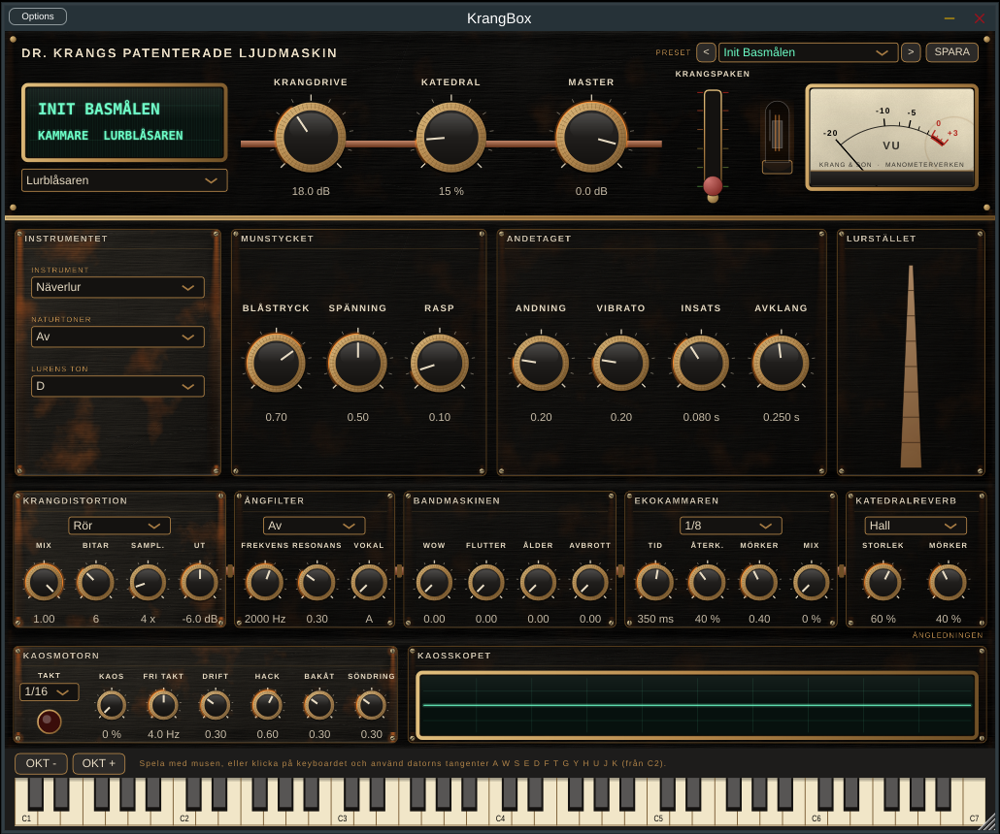

## Lutverket

Den tionde kammaren: knäppta strängar med utökad Karplus-Strong (12 toner, upp till 3 strängar per ton). Varje sträng är en återkopplad fördröjning; knäppet är ett kort brusutbrott, och en allpass stämmer in bråkdelen av ett sample så att alla toner ligger rätt.

| Instrument | Klang |
| --- | --- |
| Kantele | Metallsträngar, klar och lång |
| Luta | Tarmsträngar i körer om två, varm, med stor klanglåda |
| Cittra | Tre metallsträngar per ton, skimrande |
| Rostharpa | Rostiga strängar som surrar och vinglar ur stämning |

| Ratt | Vad den gör |
| --- | --- |
| Knäpp | Var på strängen du knäpper; mitt på försvinner de jämna övertonerna |
| Hårdhet | Mjukt fingertopp till hårt plektrum |
| Klingtid | Hur länge strängen klingar; basen klingar längre |
| Glans | Hur länge diskanten lever |
| Kör | Hur ostämda strängarna i samma kör är (cent) |
| Dämpare | Hur snabbt en släppt ton tystnar |
| Surr | Strängen slår i rostig metall när den svänger för långt |
| Botten | Klanglådan |

Krangspaken får strängarna att surra och körerna att glida isär.

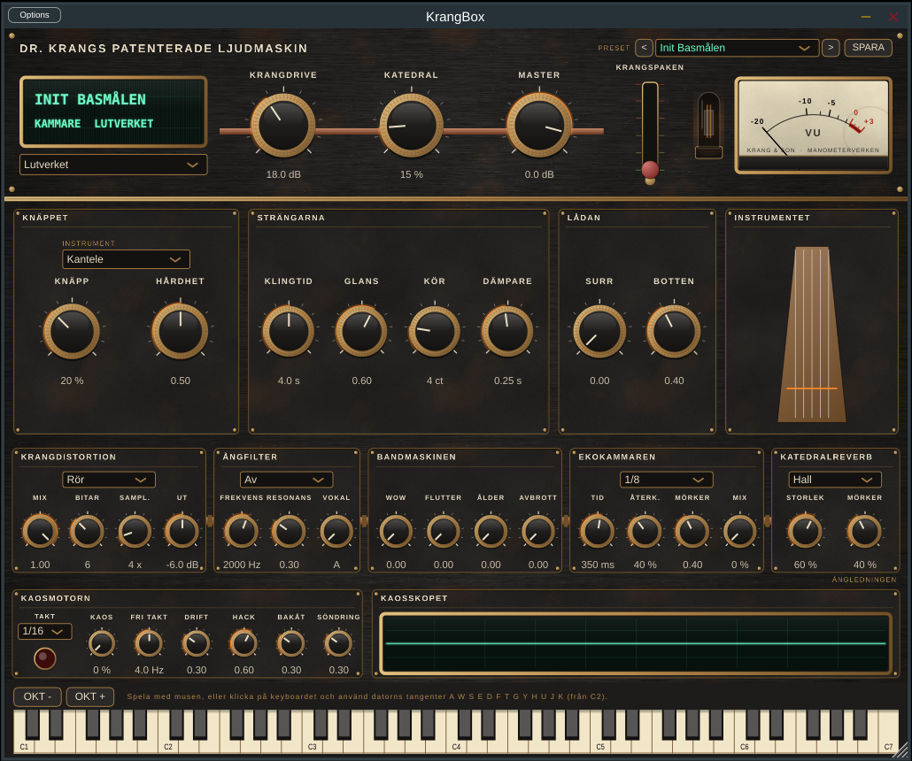

## Vattenpumpen

Den elfte kammaren: stråkad metall med modalsyntes (8 toner). Metallens svängningar är en bank resonatorer med metallens oharmoniska deltoner, och stråken driver dem medan tangenten hålls: släpp i takt med grundtonen (när hartset släpper taget) och friktionsbrus.

| Metall | Klang |
| --- | --- |
| Vattenfon | Stavar runt en vattenfylld behållare; vattnet skvalpar och deltonerna glider |
| Såg | En nästan ren, sjungande ton med brett vibrato; glider mellan tonerna med Glid |
| Plåt | Täta, mörka deltoner och rassel, som en åskplåt |
| Cymbal | Höga, skimrande deltoner – från sus till skrik |

| Ratt | Vad den gör |
| --- | --- |
| Tryck | Stråktrycket: från ren ton till skrikande metall |
| Fart | Stråkens fart, alltså styrkan |
| Vatten | Hur mycket vattnet skvalpar och drar deltonerna |
| Vibrato | Vibratots djup (brett på sågen) |
| Glid | Av = polyfont; annars legato, där tonen glider till nästa |
| Skrot | Rasslande skrot som skakar med |
| Insats, Avklang | Hur stråken tar och lyfts; metallen klingar ut av sig själv |

Krangspaken trycker stråken hårt, får skrotet att rassla och vattnet att skvalpa.

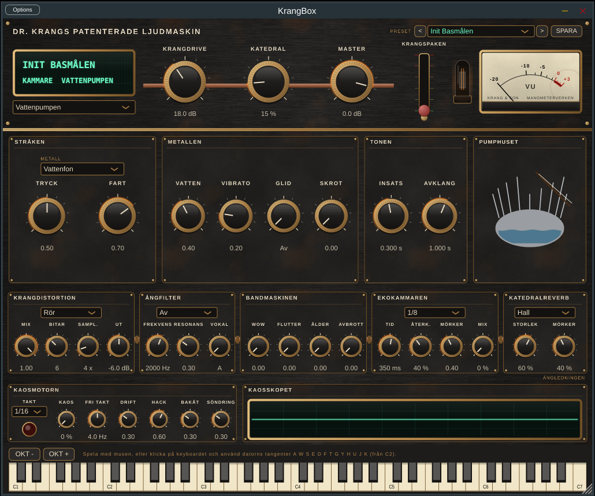

## Ångledningen (effekter)

Signalvägen är: kammare → **Kaosmotorn** → **Krangdistortion** → **Ångfilter** → **Bandmaskinen** → **Ekokammaren** → **Katedralreverb** → limiter. Allt fram till reverben är mono; reverben gör ljudet stereo.

| Effekt | Lägen | Inställningar |
| --- | --- | --- |
| Krangdistortion | Rör, Fuzz, Vikning, Bitkross | Drive, Mix, Bitar, Nedsampling, Ut |
| Ångfilter | Av, Lågpass, Högpass, Formant, Kam | Frekvens, Resonans, Vokal (A–U, för Formant) |
| Bandmaskinen | – | Wow, Flutter, Ålder, Avbrott |
| Ekokammaren | Fri, 1/4, 1/8, 1/8 punkt., 1/16, 1/4 triol | Tid (i läget Fri), Återkoppling, Mörker, Mix |
| Katedralreverb | Hall, Platta, Rostig tank (fjäderreverb) | Mix, Storlek, Mörker |

Kam ger en metallisk ton på vald frekvens, som ljud genom ett långt rör. Formant låter ljudet "säga" vokaler. Utgången har ett tak på −0,3 dBFS.

**Bandmaskinen** är ett slitet rullband: *Wow* är långsam tonhöjdsvajning, *Flutter* snabb darrning, *Ålder* ger bandmättning, sus och förlorad diskant, och *Avbrott* låter bandet tappa kontakten med tonhuvudet då och då. Med alla fyra på noll är bandmaskinen helt förbikopplad.

**Ekokammaren** är ett bandeko. I synkade lägen följer ekotiden DAW:ens tempo (eller Stegverkets tempo i standalone); i läget *Fri* gäller Tid. Varje upprepning blir mörkare (*Mörker*), och återkopplingen mättas, så att den kan vridas över 100 % till självsvängning utan att skena. Ändrar du tiden glider tonhöjden som på en riktig bandeko. Mix på noll stänger av ekot. Krangspaken driver ekot mot självsvängning om det är påslaget.

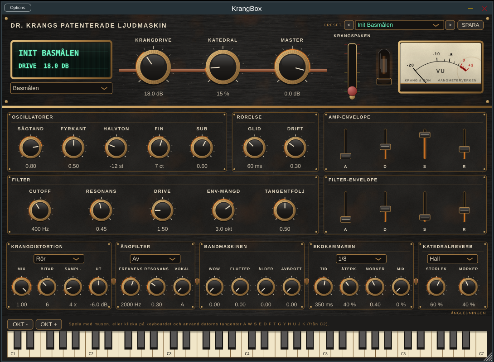

## Kaosmotorn

Kaosmotorn sitter direkt efter kammaren och gör maskinen opålitlig. Varje taktslag slår den en tärning: med sannolikheten **Kaos** händer något under nästa slag. Vad som händer väljs slumpvis, viktat efter tre rattar:

| Ratt | Vad som händer |
| --- | --- |
| Hack | En bit av det som just spelats upprepas, som en hackande skiva (ett helt, ett halvt eller ett kvarts slag) |
| Bakåt | Senaste slaget spelas baklänges |
| Söndring | Slaget samplas ned och bitreduceras, som en trasig D/A-omvandlare |

**Takt** väljer slagen: 1/4, 1/8, 1/16 eller 1/32 i DAW:ens tempo (Stegverkets i standalone), eller *Fri* med **Fri takt** i Hz. **Drift** låter tonhöjden vandra slumpmässigt, som en motor som går ojämnt. Kaoslampan blixtrar när motorn slår till. Med Kaos på noll är motorn helt förbikopplad. Krangspaken väcker Kaosmotorn även när den är avstängd.


## Presets

Uppe till höger på frontpanelen: `<` och `>` bläddrar, listan visar alla presets i kategorier och **SPARA** sparar nuvarande ljud som eget preset. Ett eget preset innehåller alla inställningar och Stegverkets mönster. DAW:ens programlista visar fabrikspresets.

| Kategori | Presets |
| --- | --- |
| Bas | Init Basmålen, Ångvisslan, Smedjans bas, Rostig sub, Kopparrörsacid, Vikt vågbas, Domedagsbas, Tyst maskin, Slitet band, Hackande maskin |
| Drön och folk | Nyckelharpsdrön, Kulning i ångan, Kamröret, Väderkvarnen, Bordunorgeln, Nyckelharpan i ruinen, Säckpipan från Ångvik, Vallflöjt i dimman, Rostorgeln, Gammal rulle |
| Leads och slingor | Spolslingan, Munharpa i maskinhallen, Kulning över ödemarken, Trasig radio, Ångslinga, Spolpuls i ruinen, Ekon från ödemarken, Radion i bunkern |
| Stålpiano | Init Stålpiano, Missionshuset, Hackbrädet, Skruvat piano, Stålregn, Kedjepianot, Hudharpan, Silkesqin, Kopparharpan |
| Klockor | Init Klockgjuteriet, Kyrkklockan i dimman, Fäbodskällan, Operagongen, Rälsen i tunneln, Sprucken kyrkklocka, Sjungande skålen |
| Kör | Init Kören, Psalm i schaktet, Kulning över dalen, Munkarna i gruvan, Högtalarkören, Spökkören |
| Radio | Init Radiomasten, Nattsändning från Moskva, SOS från skeppet, Telegraftrådarna, Fjärrskrivaren, Åska över masten |
| Blås | Init Lurblåsaren, Vallåten, Bockhornet, Skalmejan i gränden, Ångvisslan i hamnen, Rostiga luren |
| Strängar | Init Lutverket, Kantelen vid elden, Lutan i tornet, Cittrans regn, Rostharpan, Plockslinga i ruinen |
| Stråkad metall | Init Vattenpumpen, Vattenfonen i tunneln, Sjungande sågen, Plåtåskan, Cymbalens skrik, Pumpstationen |
| Trummor (med mönster) | Init Hammarverket, Smedjegång, Rostig fabrik, Folkdans i ruinerna, Ångslagets puls, Bitkrossad marsch, Katedralens slagverk, Träskedsbrygga, Ventilsystemet, Ekande smedja, Trasig trummaskin |

Fabrikspresets finns i `Source/presets/FactoryPresets.h`: varje preset listar bara det som skiljer sig från standardvärdena. Egna presets sparas som `.krang`-filer (XML) i `~/Library/Application Support/KrangBox/Presets/` och kan delas mellan datorer. Ett eget preset kan inte få samma namn som ett fabrikspreset; det får då tillägget "(eget)".

## Provspela

Öppna den fristående appen (`KrangBox.app`) eller pluginet i en DAW. Längst ned finns ett virtuellt keyboard (C1–C7): spela med musen, eller klicka på det och använd datorns tangenter `A W S E D F T G Y H U J K`. `OKT -` och `OKT +` flyttar datortangenterna en oktav; de startar på C2, bra för bas. I den fristående appen väljer du ljudkort och MIDI-ingång under *Options*.

## Struktur

| Sökväg | Innehåll | Ansvarig |
| --- | --- | --- |
| `Source/dsp/Basmalen.h` | Basmotor: 2 osc + sub, ladder-filter, envelopes, glid, drift | Sara |
| `Source/dsp/Hammarverket.h` | Trummaskin: åtta syntetiska röster och MIDI-mappning | Sara |
| `Source/dsp/Bordunorgeln.h` | Drönmotor: vågtabeller, stråkbrus, bordun, resonanssträngar | Sara |
| `Source/dsp/Spolslingan.h` | Leads och slingor: FM, munharpa, radiokorn | Sara |
| `Source/dsp/Vattenpumpen.h` | Vattenpumpen: vattenfon, såg, plåt och cymbal (stråkad modalsyntes) | Sara |
| `Source/dsp/Lutverket.h` | Lutverket: kantele, luta, cittra och rostharpa (Karplus-Strong) | Sara |
| `Source/dsp/Lurblasaren.h` | Lurblåsaren: näverlur, bockhorn, skalmeja och ångvissla, med naturtoner | Sara |
| `Source/dsp/Radiomasten.h` | Radiomasten: kortvåg, morse, vind i ledningar och interferens | Sara |
| `Source/dsp/Koren.h` | Kören i schaktet: formantsyntes, kulning och trasig högtalare | Sara |
| `Source/dsp/Klockgjuteriet.h` | Klockgjuteriet: modalsyntes för klockor, gonger, räls och skålar | Sara |
| `Source/dsp/Stalpiano.h` | Stålpiano: modalsyntes för piano, hackbräde och preparerat piano | Sara |
| `Source/dsp/Slingan.h` | Arpeggiator med värdsynk och egen klocka | Sara |
| `Source/dsp/Stegverket.h` | Stegsekvenser: mönster, värdsynk, intern klocka och gung | Sara |
| `Source/dsp/KrangDistortion.h` | Rör, Fuzz, Vikning (4x översamplat), Bitkross | Sara / Justine |
| `Source/dsp/Angledningen.h` | Ångfilter och Katedralreverb (mono in, stereo ut) | Justine |
| `Source/dsp/Kaosmotorn.h` | Kaosmotorn: hack, baklänges, söndring och slumpdrift | Sara |
| `Source/dsp/Bandmaskin.h` | Bandmaskinen (wow, flutter, ålder, avbrott) och Ekokammaren (synkat bandeko) | Justine |
| `Source/dsp/KrangEngine.h` | Kopplar ihop kammare, effekter, DC-spärr och limiter | Justine |
| `Source/Parameters.h` | Parameterträdet – ID:n får aldrig döpas om | Justine |
| `Source/ui/KrangStyle.h` | Krang-stil: LookAndFeel, ratt, fader, modulram, kopparrör, VFD-display, VU-mätare, frontpanel | Philip |
| `Source/ui/Textures.h` | Genererade texturer och bakgrundscache | Philip |
| `Source/ui/Panels.h` | Modulerna: Basmålen, Hammarverket (röster + Stegverket), Ångledningen | Philip |
| `Source/ui/StegverketPanel.h` | Stegverkets lamprutnät och transport | Philip |
| `Source/presets/` | Fabrikspresets och PresetManager (spara, ladda, DAW-program) | Doktor Krang |
| `Source/PluginEditor.*` | Krang-panelen: skalning, koppling av alla parametrar, presets, keyboard | Philip |
| `tools/KrangRender.cpp` | Offline-rendering för lyssningstest och CI | Doktor Krang |
| `tools/KrangSnapshot.cpp` | Ritar stilprovet till PNG för granskning utan DAW | Philip |
| `docs/` | Bilder på Krang-panelen, stilprovet och Stegverket | – |
| `.github/workflows/` | macOS-bygge, renderingstest och pluginval | Justine |

## Licens

GNU Affero General Public License v3.0 – se [LICENSE](LICENSE). KrangBox använder JUCE under dess AGPLv3-licens.
